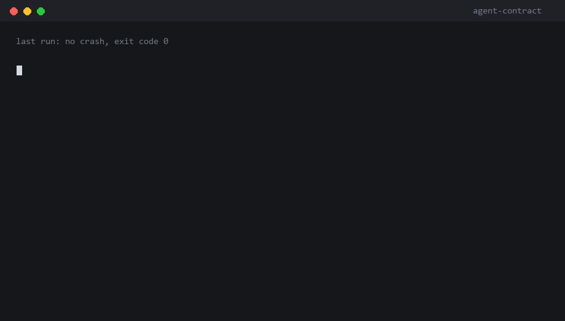
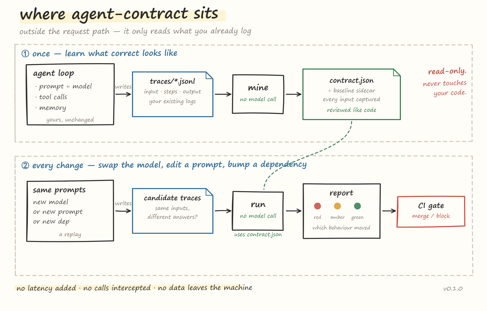

<div align="center">

# agent-contract

**Mine what "correct" looked like from your own traces — then catch the moment a model swap, a prompt edit or a dependency bump quietly changes it.**

Two commands. No model calls. No API key. No data leaves your machine.

[](https://github.com/bandageok/agent-contract/actions/workflows/ci.yml)
[](https://www.python.org)
[](pyproject.toml)
[](LICENSE)

<sub>[English](README.md) · [中文](README.zh-CN.md) · [Launch playbook](LAUNCH.md)</sub>

</div>



<div align="center"><sub><code>mine</code> learns what correct looked like. <code>run</code> finds out what changed. Exit code 1 when it matters.</sub></div>

---

## The problem

Your agent ran fine for three months. You upgraded the model. Nothing crashed, no exception, exit code 0 — and for six days it has been quoting a 3-day refund window instead of 7.

That is a **silent failure**: the shape is right, the tone is right, the facts are wrong. Traditional software throws when it breaks. An LLM app returns something that looks reasonable. The stronger the model, the more plausible the mistake.

Nobody has CI for this, so teams sample 20 conversations by hand — or ship and hope.

## The 30-second version

```bash
# 1. learn what correct looked like, from traces that already worked
agent-contract mine --traces traces/ -o contract.json

# 2. after swapping the model, replay the same prompts and compare
agent-contract run --contract contract.json --target traces-candidate/
```

Exit code `1` when an assertion breaks. That is the whole product.

## Quickstart

```bash
pip install "agent-contract @ git+https://github.com/bandageok/agent-contract"

agent-contract mine --traces examples/traces-baseline.jsonl -o contract.json
agent-contract run  --contract contract.json --target examples/traces-candidate.jsonl
```

`contract.json` goes in git and gets reviewed like code. `contract.baseline.jsonl` sits next to it and holds the reference answers every replay is compared against. Commit both.

## Where it sits in your stack



<div align="center"><sub>It does not sit inside your agent. It sits on either side of it: after the traces, before the merge.</sub></div>

The diagram answers "which layer", so here it is in text as well.

```
user request
   │
   ▼
┌──────────────────────────────────────────┐
│  agent runtime                           │   ← not here
│  prompt · tool calls · memory · retries  │     (no middleware, no SDK, no proxy)
└──────────────────────────────────────────┘
   │  writes
   ▼
┌──────────────────────────────────────────┐
│  traces / logs you already keep          │   ← reads here
└──────────────────────────────────────────┘
   │
   ▼
┌──────────────────────────────────────────┐
│  CI / release gate                       │   ← blocks here
└──────────────────────────────────────────┘
```

Three consequences worth stating plainly:

- **It is not a middleware.** Nothing is wrapped, nothing is intercepted, no latency is added. Your agent runs exactly as it did before.
- **Its unit of time is a release, not a request.** It compares two versions of your agent, not two users.
- **It is only as good as your traces.** No traces, no gate.

The closest analogy is a golden test: a compiler does not need tests to compile, but nobody ships a compiler without them. Agents have been shipping without theirs.

## What it catches

| Kind | Catches | Example |
|---|---|---|
| `shape.tool_result_not_empty` | empty payloads | `search_docs` returned `[]` and the agent carried on |
| `shape.result_not_degenerate` | successful-looking but zeroed payloads | `{"content_chars": 0, "bytes": 0}` |
| `shape.result_has_field` / `result_len_range` | missing fields, length blowups | a field silently dropped by a serialiser |
| `action.tool_allowed` / `tool_pair_allowed` | new tools, changed call order | an escalation path appeared |
| `action.path_within_root` | files touched outside the workspace | reading `../secrets/key.pem` |
| `action.max_calls` | runaway loops | the same tool called 12 times |
| `drift.batch` | any answer drifting from the baseline — facts changed, numbers moved, text rewritten | "7 days" became "3 days"; `830 lines` became `277 lines` |

`mine` writes assertions **with evidence** — how many observations justified each one. An assertion with no history behind it is a guess, and guesses are why people switch linters off.

`run` reports three states:

- 🟢 **green** — unchanged
- 🟡 **amber** — moved but stayed in bounds (one extra retry, a new tool)
- 🔴 **red** — an assertion from history is now violated

No scores. A score gets optimised; a traffic light gets acted on.

## What a report looks like

The bundled example: 40 baseline traces, 40 candidate traces, four deliberate drifts.

```
agent-contract · 20 assertions · 40 target traces

RED   A10  shape.tool_result_not_empty  search_docs never returns an empty result
      2/40 calls returned an empty result (5.0%)
      └ trace=c-018, tool=search_docs, reason=empty result
RED   A16  action.path_within_root      read_file keeps `path` inside docs
      1/40 `path` values escaped `docs`
      └ trace=c-012, path=../secrets/key.pem, allowed=docs
RED   A20  drift.batch                  answers to the baseline inputs stay the same
      5/40 matched answers drifted
      └ trace=c-001, input=What is the refund window for international orders?,
        why=facts lost, detail=['duration:7days']
AMBER A14  action.tool_allowed          only tools seen in the baseline are called
      new tool(s) surfaced: escalate_to_human

3 red · 2 amber · 15 green  →  FAIL
```

`--format markdown` produces a version meant for a PR comment; `--format json` for anything else.

## Trace formats

Point `--traces` at files, directories or globs. Every record is normalised; unknown keys are kept in `meta`.

**Documented shape**

```json
{"id": "t-1", "input": "refund window?", "output": "7 days",
 "steps": [{"kind": "tool", "name": "search_docs", "args": {"q": "refund"},
            "result": {"items": [], "total": 0}}]}
```

**OpenAI chat** — `{"messages": [...]}` with `tool_calls` and `role: "tool"` replies is paired automatically.

**LangChain** — `{"inputs": ..., "outputs": ..., "intermediate_steps": [...]}`.

A bare `{"input": ..., "output": ...}` pair still works for drift checks.

> Drift compares answers to the **same input**, so the target batch should replay the baseline's prompts. When coverage drops, the report says so — it will not show you a wall of green from assertions that never ran.

## In CI

```yaml
- uses: bandageok/agent-contract@main
  with:
    contract: contract.json
    target: traces/candidate/*.jsonl
    fail-on: red
```

The markdown report is appended to the job summary, so a reviewer sees which behaviour moved without opening the logs.

## Validated on real data

The fixture set was too clean. Run against 60 real files — paths with spaces and apostrophes, every input distinct, sizes 0–54 KB — the tool reported **all green on a batch with three deliberate regressions**. Five defects fell out:

| Defect | Fix |
|---|---|
| `{"content_chars": 0, "bytes": 0}` counted as a non-empty result | `is_degenerate()` + `shape.result_not_degenerate` |
| relative paths share no common prefix, so path assertions were never emitted — exactly the tool that needed protecting | allowed-directory fallback |
| a drift that only moves numbers scored 0.87 similarity, above the 0.55 floor | number extraction added to the drift comparison |
| the unit list missed `lines`, `characters`, `tokens`, `entries` | fact patterns extended |
| drift covered a **sample** of inputs — 25 of 60 — so a file that actually changed was never checked | the whole baseline goes into a sidecar; every replayed input is compared |

The last one is the important one. Sampling the thing that decides pass/fail is how a gate becomes decorative.

The strongest check was unscripted: with a baseline in place, one real file was edited by a single byte. Next run:

```
1/56 matched answers drifted
└ input=summarise file: .research/raw/hn_2.json, why=facts lost,
  detail=['count:1lines', 'count:57330characters']
```

Exactly one input named, 55 green, no false positives. Self-comparison (baseline vs baseline) is 0 red. On 5 000 traces: `mine` 0.4 s, `run` 0.8 s.

Reproduce it yourself:

```bash
python tools/collect_fs.py /path/to/a/messy/directory /tmp/fs
agent-contract mine --traces /tmp/fs/fs-baseline.jsonl -o /tmp/fs/contract.json
agent-contract run  --contract /tmp/fs/contract.json --target /tmp/fs/fs-candidate.jsonl
```

## Design choices

**Zero runtime dependencies.** Standard library only. Runs in a locked-down CI container, on a laptop, offline.

**No model calls.** Comparison is token-set similarity plus fact and number extraction, not embeddings. A gate that needs an API key and costs money per run is a gate people disable.

**Local only.** Traces never leave the machine. No account, no upload, no telemetry.

**Evidence or nothing.** Every mined assertion prints how many observations justified it.

**Deterministic output.** Assertion ids and ordering are stable, so a re-mine produces a reviewable diff instead of a rewrite.

## What it does not do

- It does not make your agent smarter or fix hallucinations. It detects **change**, not badness on day one.
- It is not an observability platform. It reads traces; it does not store or visualise them.
- It does not write your test cases. It infers them — the inference can be wrong, so review the contract once before trusting the gate.

## Status

`0.1.0` — the loop works end to end, 61 tests, 88% statement coverage, validated against real filesystem data. Interfaces may change before `1.0`.

Roadmap: a replay harness (so you never hand-assemble the candidate batch), HTML report, per-branch baseline pinning, and a `--from-logs` adapter for plain application logs.

Two open questions before `1.0`: how the sidecar should scale past ~50k inputs, and whether token-set similarity is enough for non-English answers. Neither is settled.

## Contributing

Three additions are small enough to land in an afternoon and are exactly what the tool is missing:

- a trace adapter for Bedrock, Vercel AI SDK, or your own logger
- fact unit patterns for your language (Chinese `万元`, `个工作日`, currency codes)
- a `--format html` report

See [CONTRIBUTING.md](CONTRIBUTING.md). If this saves you one incident, a star helps the next person find it.

## License

MIT

<div align="center"><sub>Diagram source: <a href="tools/make_diagram.py">tools/make_diagram.py</a> → <code>python tools/make_diagram.py docs/architecture.svg --png</code></sub></div>