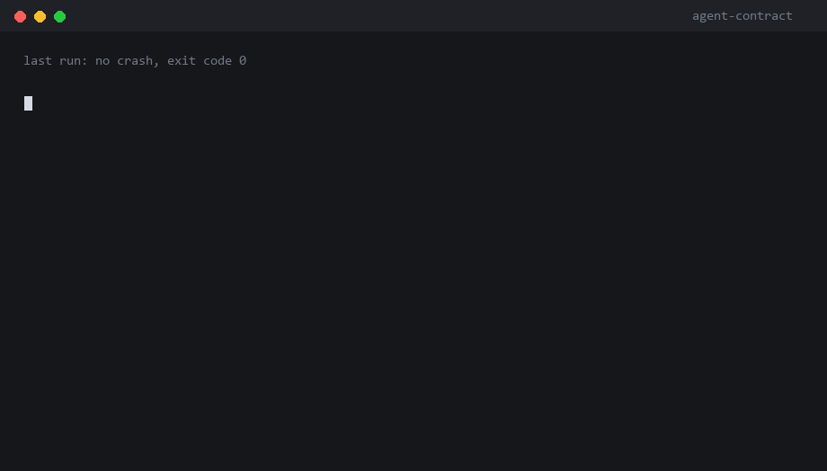

# agent-contract

**从你自己的运行记录里挖出「什么算对」，然后每次换模型、改 prompt、升依赖，跑一遍就知道哪几个行为悄悄变了。**

两条命令。不调模型。不需要 API key。数据不出本机。

[English](README.md) · [架构图](docs/architecture.png)



---

## 它在解决什么

你的 agent 稳定跑了三个月。你换了模型。没崩、没异常、退出码 0——然后六天里它一直把「7 天退款」说成「3 天」。

这叫**静默失败**：格式对、语气对、事实错。传统软件坏了会抛异常，LLM 应用坏了会返回一段看起来正常的话。**模型越强，错得越像对的。**

这件事没有 CI，团队只能人工抽查 20 条对话——或者赌。

## 两条命令

```bash
# 1. 从跑对过的记录里学习「正确」长什么样
agent-contract mine --traces traces/ -o contract.json

# 2. 换完模型，重放同样的 prompt，逐条比对
agent-contract run --contract contract.json --target traces-candidate/
```

断言被打破时退出码是 `1`，直接进 CI。

## 它在你的哪一层

**不在 agent 里面。**

```
用户请求
   │
   ▼
┌──────────────────────────────────────────┐
│  agent 运行时                             │   ← 不在这里
│  prompt · 工具调用 · 记忆 · 重试           │     没有中间件、没有 SDK、没有代理
└──────────────────────────────────────────┘
   │  写入
   ▼
┌──────────────────────────────────────────┐
│  你本来就有的 traces / 日志                │   ← 读这里
└──────────────────────────────────────────┘
   │
   ▼
┌──────────────────────────────────────────┐
│  CI / 发布闸门                            │   ← 拦这里
└──────────────────────────────────────────┘
```

三个推论：**不加延迟**（不拦截任何调用）；**时间粒度是「一次发布」，不是「一次请求」**；**没有 trace 就没有门**。

最接近的类比是 golden test：编译器不需要测试也能编译，但没人不测试就发编译器。agent 一直是这样上线的。

## 能抓到什么

| 断言 | 抓什么 | 例子 |
|---|---|---|
| `shape.tool_result_not_empty` | 空结果 | `search_docs` 返回 `[]`，agent 继续往下走 |
| `shape.result_not_degenerate` | 「成功」但内容为零 | `{"content_chars": 0, "bytes": 0}` |
| `shape.result_has_field` | 字段被静默丢弃 | 序列化时少了一个字段 |
| `action.path_within_root` | 越界读写 | 读了 `../secrets/key.pem` |
| `action.tool_allowed` | 出现了新工具 | 多了一条升级到人工的路径 |
| `action.max_calls` | 死循环 | 同一个工具被调用 12 次 |
| `drift.batch` | 答案漂移 | 「7 天」变「3 天」；`830 行` 变 `277 行` |

`mine` 写出的每一条断言都带 **evidence**——历史上多少次观察支撑它。没有证据的断言就是猜测，而猜测正是人们关掉 lint 的原因。

`run` 只给三种状态：🔴 违反 · 🟡 变了但没越界 · 🟢 没变。**不打分**。分数会被优化，红绿灯不会。

## 真实数据验证

合成数据集太干净了。拿 60 个真实文件（路径带空格和单引号、每条输入都不同、0–54KB）跑，工具在**三个已知回归上报告全绿**。五个缺陷因此暴露，最严重的一个是：漂移只抽查了 60 个输入里的 25 个，真正变化的那个文件从未被检查。

**抽样决定通过与否，等于门是装饰。** 现在基线全量存 sidecar，每次重放逐条比对。

最强的一次验证没有脚本：基线建好后给一个真实文件追加一个字节，下次运行报出恰好那一条，其余 55 条全绿。

## 安装

```bash
pip install "agent-contract @ git+https://github.com/bandageok/agent-contract"
```

零运行时依赖（只用标准库），Python 3.9+。

支持三种 trace 格式：本文档定义的形状、OpenAI chat（`{"messages": [...]}`）、LangChain（`intermediate_steps`）。未知字段会保留在 `meta` 里，不会丢。

## 边界

- 它**不**让你的 agent 变聪明，也**不**修幻觉。它检测的是**变化**，不是第一天的好坏。
- 它**不是**可观测平台。它读 trace，不存、不画。
- 它**不**替你写测试用例——它推断，而推断会错。所以第一次生成的契约要人看一眼。

## 参与

`CONTRIBUTING.md` 里三个约定最重要：不加运行时依赖、每条断言必须有证据、检查路径里不许调模型。

改造入口（都是半天能做完的）：新的 trace 适配器、中文事实单位（`万元`、`个工作日`）、`--format html`。

## License

MIT